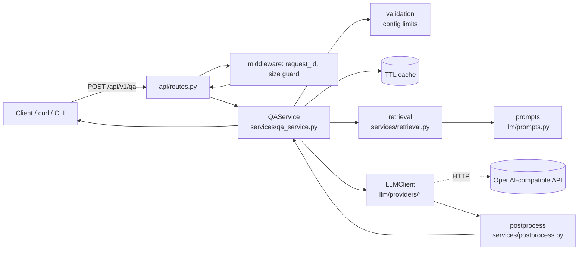

# docqa-service

[](https://github.com/blackurs/docqa-service/actions/workflows/ci.yml)
[](pyproject.toml)
[](LICENSE)

Production-like **Q&A по документу** на FastAPI и LLM: пользователь присылает вопрос и
текст документа, сервис выбирает релевантные фрагменты, отправляет их модели, чистит
ответ и возвращает его вместе с цитатами.

Сервис спроектирован как учебный «production-like» пример: явные слои, типизированные
ошибки, структурированные логи, TTL-кеш, CI, конфигурация через переменные окружения и
безопасная работа с секретами.

```
POST /api/v1/qa  →  вопрос + документ  →  ответ + цитаты + метаданные
```

## Возможности

| Требование | Реализация |
|---|---|
| Разделение ответственности | `api/` (HTTP), `services/` (бизнес-логика), `llm/` (провайдеры, промпты), `core/` (конфиг, логи, кеш, ошибки) |
| Валидация входа | Pydantic-схемы + доменные лимиты из конфигурации → HTTP 422 |
| Ошибки LLM | Таймауты, ретраи с экспоненциальной задержкой, типизированные ошибки (429/5xx/сеть/битый ответ) |
| Fallback | При недоступности модели — HTTP 200 с `degraded=true` и экстрактивным ответом из документа; строгий режим → HTTP 503 |
| Логирование | JSON-логи с `request_id`, уровнями и этапами: запрос → промпт → ответ → ошибка |
| Кеширование | TTL + LRU, ключ учитывает вопрос/документ/модель/top_k, заголовок `X-Cache`, логи `cache_hit`/`cache_miss` |
| CI | GitHub Actions: ruff, pytest (3.9/3.11/3.12), `pip check`, сборка пакета, `docker build` |
| Конфигурация | `.env` + `config/dev.env` + `config/prod.env`, приоритеты задокументированы, секреты не в коде |
| Секреты | `SecretStr`, `.env` в `.gitignore`, `.env.example` в репозитории |
| Документация | README, `docs/ARCHITECTURE.md`, `TESTING.md`, `PULL_REQUEST.md` |

## Архитектура



Поток обработки запроса:

1. **API** — валидирует JSON, присваивает `request_id`, ограничивает размер тела.
2. **QAService** — проверяет бизнес-лимиты, смотрит кеш, вызывает ретривер и LLM,
   применяет fallback, пишет в кеш.
3. **Retrieval** — делит документ на предложения, ранжирует их TF-IDF-подобной
   лексической оценкой, возвращает `top_k` фрагментов в порядке релевантности.
4. **LLM** — собирает system+user промпт, вызывает провайдера с таймаутом и ретраями.
5. **Post-processing** — убирает префиксы вида `Answer:`, markdown-заборы, лишние
   пробелы, ограничивает длину; пустой ответ считается ошибкой и уходит в fallback.

Подробнее: [`docs/ARCHITECTURE.md`](docs/ARCHITECTURE.md).

## Структура репозитория

```
docqa-service/
├── .github/workflows/ci.yml     # линтер, тесты, сборка, Docker
├── config/
│   ├── dev.env                  # настройки окружения dev (без секретов)
│   └── prod.env                 # настройки окружения prod (без секретов)
├── data/sample_document.txt     # документ для демо
├── docs/ARCHITECTURE.md
├── scripts/demo.py              # сквозное демо 5 сценариев
├── src/docqa/
│   ├── main.py                  # app factory + ASGI entrypoint
│   ├── cli.py                   # CLI: serve / ask
│   ├── api/                     # routes, schemas, deps, errors, middleware
│   ├── core/                    # config, logging, errors, cache, metrics
│   ├── llm/                     # base, prompts, factory, providers/{mock,openai_compat}
│   └── services/                # qa_service, retrieval, postprocess
├── tests/                       # 99 тестов (unit + API + provider)
├── .env.example
├── pyproject.toml
├── requirements.txt / requirements-dev.txt
├── Dockerfile / docker-compose.yml
├── Makefile / run.bat / run.sh
├── README.md / TESTING.md / PULL_REQUEST.md
```

## Быстрый старт

Требования: Python 3.9+, Git. API-ключ **не нужен** для запуска: по умолчанию
используется детерминированный mock-провайдер.

### Windows — одна команда

```bat
run.bat
```

Скрипт создаст `.venv`, установит зависимости, скопирует `.env.example` → `.env`
и поднимет API на <http://127.0.0.1:8000>.

### Linux / macOS

```bash
./run.sh
```

### Вручную

```bash
python -m venv .venv
source .venv/bin/activate          # Windows: .venv\Scripts\activate
pip install -r requirements-dev.txt
pip install -e .
cp .env.example .env
python -m docqa.cli serve          # или: uvicorn docqa.main:app --reload
```

Проверка:

```bash
curl http://127.0.0.1:8000/health
```

Swagger UI: <http://127.0.0.1:8000/docs>, OpenAPI: `/openapi.json`.

### Docker

```bash
docker build -t docqa-service .
docker run --rm -p 8000:8000 docqa-service
# с реальной моделью:
docker run --rm -p 8000:8000 -e APP_ENV=prod -e LLM_PROVIDER=openai \
  -e LLM_API_KEY=sk-... -e LLM_MODEL=gpt-4o-mini docqa-service
```

## API

### `POST /api/v1/qa`

Запрос:

```json
{
  "question": "Сколько секунд таймаут по умолчанию?",
  "context": "По умолчанию клиент LLM использует таймаут 20 секунд. ...",
  "top_k": 3,
  "allow_fallback": true
}
```

| Поле | Тип | Обязательно | Описание |
|---|---|---|---|
| `question` | string | да | Вопрос; бизнес-лимит `MAX_QUESTION_CHARS` (по умолчанию 500) |
| `context` | string | да | Текст документа; лимит `MAX_CONTEXT_CHARS` (20 000) |
| `top_k` | int 1..20 | нет | Сколько фрагментов передать модели (по умолчанию `TOP_K_EXCERPTS=4`) |
| `allow_fallback` | bool | нет | `false` → при сбое LLM вернуть 503 вместо деградированного ответа |

Успешный ответ `200 OK`:

```json
{
  "request_id": "1e5c236935ad49d4a45ad6215e3c3c78",
  "answer": "По умолчанию клиент LLM использует таймаут 20 секунд.",
  "citations": [
    {"index": 1, "text": "По умолчанию клиент LLM использует таймаут 20 секунд.", "score": 3.1656},
    {"index": 2, "text": "Результаты успешных ответов кешируются на 300 секунд по умолчанию (CACHE_TTL_SECONDS).", "score": 1.9741}
  ],
  "degraded": false,
  "degradation_reason": null,
  "cached": false,
  "provider": "mock",
  "model": "mock-qa-1",
  "latency_ms": 40.611,
  "usage": {"prompt_tokens": 192, "completion_tokens": 35}
}
```

Заголовки ответа:

| Заголовок | Значение |
|---|---|
| `X-Request-ID` | id запроса (входящий или сгенерированный); дублируется в теле и логах |
| `X-Cache` | `HIT` / `MISS` |
| `X-Degraded` | `true`, если ответ получен через fallback |
| `X-Degradation-Reason` | код причины: `llm_unavailable`, `llm_timeout`, `postprocessing_error` |

### Статусы и ошибки

| HTTP | Код `error.code` | Когда |
|---|---|---|
| 200 | — | Успех (в т.ч. fallback с `degraded=true`) |
| 413 | `payload_too_large` | Тело больше `APP_MAX_REQUEST_BYTES` |
| 422 | `validation_error` | Невалидный JSON, пустой/длинный вопрос, пустой/длинный документ |
| 429 | `llm_rate_limited` | Провайдер вернул 429 после ретраев |
| 502 | `llm_bad_response` | Провайдер вернул некорректный ответ |
| 503 | `llm_unavailable` | Провайдер недоступен, fallback запрещён |
| 504 | `llm_timeout` | Таймаут провайдера, fallback запрещён |
| 500 | `internal_error` | Непредвиденная ошибка (детали только в логах) |

Единый формат ошибки:

```json
{
  "error": {
    "code": "validation_error",
    "message": "Request payload failed validation",
    "details": [{"field": "body.question", "reason": "Value must not be blank"}],
    "request_id": "732ef37a26e145ae8c9dc802eb6862d3"
  }
}
```

### `GET /health`

Статус сервиса, версия, окружение, провайдер, статистика кеша (hits/misses/hit_rate,
expired, evictions) и счётчики (requests, fallbacks, cache_hits и т.д.).

### `GET /ready`

Readiness-проба: проверяет, что провайдер сконфигурирован (для `openai` нужен ключ).

## Примеры запросов

### Успешный сценарий

```bash
curl -s -X POST http://127.0.0.1:8000/api/v1/qa \
  -H "Content-Type: application/json" \
  -d '{
    "question": "Сколько секунд таймаут по умолчанию?",
    "context": "По умолчанию клиент LLM использует таймаут 20 секунд. Таймаут настраивается переменной LLM_TIMEOUT_SECONDS."
  }'
```

PowerShell:

```powershell
$body = @{
  question = "Сколько секунд таймаут по умолчанию?"
  context  = "По умолчанию клиент LLM использует таймаут 20 секунд. Таймаут настраивается переменной LLM_TIMEOUT_SECONDS."
} | ConvertTo-Json
Invoke-RestMethod -Method Post -Uri http://127.0.0.1:8000/api/v1/qa `
  -ContentType "application/json; charset=utf-8" -Body ([Text.Encoding]::UTF8.GetBytes($body))
```

### Ошибка валидации (422)

```bash
curl -s -X POST http://127.0.0.1:8000/api/v1/qa \
  -H "Content-Type: application/json" \
  -d '{"question": "  ", "context": "Документ содержит достаточно текста."}'
```

### Fallback (LLM недоступен)

```bash
# поднять сервис с имитацией сбоя провайдера
MOCK_FAIL_MODE=error python -m docqa.cli serve --port 8001

curl -s -X POST http://127.0.0.1:8001/api/v1/qa \
  -H "Content-Type: application/json" \
  -d '{"question": "Какой таймаут по умолчанию?", "context": "По умолчанию клиент LLM использует таймаут 20 секунд."}'
# → 200 OK, "degraded": true, "degradation_reason": "llm_unavailable"
```

### Кеш (повторный запрос)

Повторите первый запрос — ответ придёт с `X-Cache: HIT`, `"cached": true` и заметно
меньшей `latency_ms`. В логах появится `cache_hit`.

### CLI

```bash
python -m docqa.cli ask -f data/sample_document.txt \
  -q "Сколько секунд таймаут по умолчанию?"
python -m docqa.cli ask -f data/sample_document.txt -q "..." --json
```

## Конфигурация

Приоритет (выше — важнее):

1. переменные окружения ОС (Docker/k8s/CI);
2. `config/<APP_ENV>.env` — окружение dev/prod, без секретов;
3. `.env` — локальный файл, в `.gitignore`;
4. значения по умолчанию в `src/docqa/core/config.py`.

Основные переменные (полный список — в [`.env.example`](.env.example)):

| Переменная | По умолчанию | Назначение |
|---|---|---|
| `APP_ENV` | `dev` | `dev` / `test` / `prod`; в `prod` mock-провайдер запрещён |
| `APP_HOST`, `APP_PORT` | `127.0.0.1`, `8000` | Адрес API |
| `APP_LOG_LEVEL`, `APP_LOG_FORMAT` | `INFO`, `json` | Логи: `json` или `text` |
| `APP_MAX_REQUEST_BYTES` | `262144` | Лимит тела запроса |
| `LLM_PROVIDER` | `mock` | `mock` или `openai` (OpenAI-совместимый API) |
| `LLM_API_KEY` | — | Секрет; обязателен для `openai` |
| `LLM_BASE_URL` | `https://api.openai.com/v1` | Endpoint провайдера |
| `LLM_MODEL` | `gpt-4o-mini` | Имя модели |
| `LLM_TIMEOUT_SECONDS` | `20` | Таймаут HTTP-запроса |
| `LLM_MAX_RETRIES` | `2` | Повторы при таймауте/429/5xx |
| `CACHE_ENABLED` | `true` | Включить кеш |
| `CACHE_TTL_SECONDS` | `300` | TTL записи |
| `CACHE_MAX_ENTRIES` | `1000` | LRU-лимит |
| `FALLBACK_ENABLED` | `true` | Разрешить fallback |
| `MAX_QUESTION_CHARS` | `500` | Бизнес-лимит вопроса |
| `MAX_CONTEXT_CHARS` | `20000` | Бизнес-лимит документа |

Секреты: ключ хранится как `SecretStr`, маскируется в `repr()`/`safe_dict()`, `.env`
исключён из Git, в репозитории только `.env.example`.

## LLM-провайдеры

* **`mock`** — офлайн, без ключа и сети; детерминированные ответы из фрагментов,
  имитация сбоев (`MOCK_FAIL_MODE=none|timeout|error|empty`). Используется в CI и демо.
* **`openai`** — любой OpenAI-совместимый `/chat/completions` (OpenAI, vLLM, Ollama,
  прокси GigaChat/YandexGPT): задайте `LLM_BASE_URL` и `LLM_MODEL`.

Настройка под реального провайдера:

```dotenv
LLM_PROVIDER=openai
LLM_API_KEY=sk-...
LLM_BASE_URL=https://api.openai.com/v1
LLM_MODEL=gpt-4o-mini
```

## Логирование

Один JSON-объект на строку, `request_id` во всех записях:

```json
{"ts":"2026-11-26T08:37:55.516+00:00","level":"INFO","logger":"docqa.services.qa_service","message":"prompt_built","event":"prompt_built","request_id":"...","question_chars":36,"excerpts":4}
```

Ключевые события: `request_received`, `cache_hit`/`cache_miss`, `prompt_built`,
`model_response`, `llm_call_failed`, `fallback_used`, `postprocessing_failed`,
`answer_ready`, `request_completed`, `app_error`. Полный текст документа и промпта
не пишется на INFO; на DEBUG доступен усечённый превью промпта.

## Тесты и качество

```bash
pytest                 # 99 тестов
ruff check .           # линтер
ruff format --check .  # форматирование
python scripts/demo.py # сквозное демо (5 сценариев)
```

Покрыто: валидация, ретраи/таймауты провайдера, fallback и строгий режим, кеш и TTL,
пост-обработка, ретривер, конфигурация и маскирование секретов, API-контракт.

Результаты ручной проверки и реальные выводы: [`TESTING.md`](TESTING.md).

## CI

Workflow: [`.github/workflows/ci.yml`](.github/workflows/ci.yml). Последний прогон —
[Actions](https://github.com/blackurs/docqa-service/actions/workflows/ci.yml).

* **lint** — `ruff check` + `ruff format --check`;
* **test** — Python 3.9/3.11/3.12, установка зависимостей и пакета, `pip check`,
  импорт приложения, `pytest`, сборка wheel/sdist;
* **docker** — сборка образа.

## Ограничения и развитие

* Кеш in-memory: на несколько реплик нужен Redis (интерфейс `TTLCache` изолирован).
* Ретривер лексический: для больших документов стоит добавить эмбеддинги/векторную БД.
* Нет аутентификации и rate limiting на уровне API — для публичного продакшена нужны
  API-gateway/лимиты.
* Метрики in-process: для продакшена — Prometheus/OpenTelemetry.

## Лицензия

MIT — см. [`LICENSE`](LICENSE).
